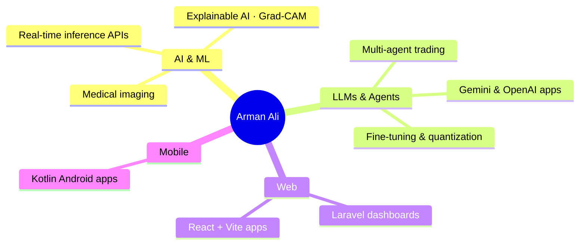
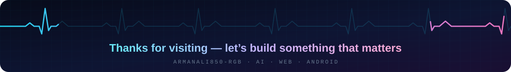

<div align="center">



<a href="https://github.com/armanali850-rgb">
  
</a>

<p>
  <a href="https://github.com/armanali850-rgb"></a>
  <a href="mailto:armanali850@gmail.com"></a>
  <!-- Add your links here by removing the comment markers around a line and pasting your URL:
  <a href="https://www.linkedin.com/in/YOUR-HANDLE"></a>
  <a href="https://x.com/YOUR-HANDLE"></a>
  <a href="https://YOUR-PORTFOLIO-URL"></a>
  -->
</p>


<br><br>

**[About](#about) · [Tech Stack](#stack) · [Projects](#projects) · [Analytics](#stats) · [Focus](#focus) · [Contact](#contact)**

</div>

<br>



I'm a **Software Engineer** who loves turning AI research into things people can actually use — from deep-learning models that read **medical images** and *explain* their predictions, to **LLMs** I fine-tune and run locally, to **multi-agent systems** that reason together.

I don't stop at the notebook: I wrap models in **FastAPI** services, build the **Laravel / React** dashboards around them, and ship **Kotlin Android** apps — so an idea goes all the way from a training run to a real product.

### ⚡ Quick Facts

- 🩻 Built **XRayInsight-AI** — DenseNet-121 + Grad-CAM chest X-ray analysis
- 🧠 Experimenting with **LLM fine-tuning, RL & quantization**
- 🤖 Building **multi-agent LLM systems** for trading & productivity
- 🌐 Shipping **role-based dashboards** with Laravel & PHP
- 📱 Building **native Android apps** with Kotlin
- 👯 Happy to **collaborate on AI & open-source** projects
- 📫 Reach me at **[armanali850@gmail.com](mailto:armanali850@gmail.com)**

<br clear="right" />

<a name="about"></a>


```python
class ArmanAli:
    role     = "AI/ML Engineer & Full-Stack Developer"
    location = "🌍 Open to remote"
    email    = "armanali850@gmail.com"

    focus = [
        "🩻 Medical imaging AI — classification + explainability (Grad-CAM)",
        "🧠 LLM fine-tuning, reinforcement learning & quantization",
        "🤖 Multi-agent LLM systems that collaborate on decisions",
        "🌐 Full-stack platforms with role-based dashboards",
        "📱 Native Android apps in Kotlin",
    ]

    stack = {
        "languages": ["Python", "JavaScript", "PHP", "Kotlin", "SQL"],
        "ai_ml":     ["PyTorch", "Hugging Face", "LangChain", "OpenAI", "Gemini"],
        "backend":   ["FastAPI", "Laravel", "Node.js"],
        "frontend":  ["React", "Vite", "Blade", "Tailwind"],
        "mobile":    ["Kotlin", "Android SDK"],
        "data":      ["MySQL", "SQLite"],
    }

    def motto(self) -> str:
        return "Train it. Explain it. Ship it."
```

<a name="stack"></a>


<table align="center">
  <tr>
    <td align="center" width="160"><b>🧠 AI · ML · LLMs</b></td>
    <td>
      <br>
      <a href="https://huggingface.co"></a>
      <a href="https://www.langchain.com"></a>
      <a href="https://platform.openai.com"></a>
      <a href="https://ai.google.dev"></a>
      <a href="https://numpy.org"></a>
      <a href="https://pandas.pydata.org"></a>
      <a href="https://jupyter.org"></a>
      <a href="https://colab.research.google.com"></a>
    </td>
  </tr>
  <tr>
    <td align="center"><b>🌐 Frontend</b></td>
    <td></td>
  </tr>
  <tr>
    <td align="center"><b>⚙️ Backend & Data</b></td>
    <td></td>
  </tr>
  <tr>
    <td align="center"><b>📱 Mobile</b></td>
    <td></td>
  </tr>
  <tr>
    <td align="center"><b>🛠️ Tools & Automation</b></td>
    <td></td>
  </tr>
</table>

<a name="projects"></a>


### ⭐ Flagship — [XRayInsight-AI](https://github.com/armanali850-rgb/XRayInsight-AI)

> *An AI radiology assistant that doesn't just predict — it shows where it looked.*

- 🧠 **DenseNet-121** fine-tuned in **PyTorch** to classify lung conditions from chest X-rays
- 🔥 **Grad-CAM heatmaps** highlight the regions that drove each prediction
- 📊 **Per-class confidence scores**, so results are never a black box
- ⚡ **FastAPI** backend for real-time inference, with **prediction history** for reviewing past scans

<a href="https://github.com/armanali850-rgb/XRayInsight-AI"></a>
   

#### 🤖 AI · LLMs · Agents

| Project | What it does | Built with |
|---|---|---|
| 🧠 [**Unsloth-LLM-Studio**](https://github.com/armanali850-rgb/Unsloth-LLM-Studio) | GPU-optimized LLM fine-tuning, reinforcement learning and quantization, with a web UI to run models locally. |   |
| 📈 [**TradingAgent**](https://github.com/armanali850-rgb/TradingAgent) | Multiple LLM agents collaborate to analyze market trends, weigh risk and support trading decisions. |   |
| 📋 [**FlowManager-AI**](https://github.com/armanali850-rgb/FlowManager-AI) | CLI project-management assistant that tracks tasks, writes progress summaries and flags blockers. |   |
| 💬 [**GeminiFlow-AI**](https://github.com/armanali850-rgb/GeminiFlow-AI) | Responsive chatbot with real-time Gemini responses, typing animations and a modern chat UI. |   |

#### 🌐 Web · 📱 Mobile · 🔁 Automation

| Project | What it does | Built with |
|---|---|---|
| 🎀 [**Pinkme_Dashboard**](https://github.com/armanali850-rgb/Pinkme_Dashboard) | Patient & program management — role-based dashboards, case management, events and financial workflows. |   |
| 🏫 [**EduCore-School-Management**](https://github.com/armanali850-rgb/EduCore-School-Management) | School management with portals for students, teachers, admins and registrar staff. |   |
| 💰 [**FinTrack-Android**](https://github.com/armanali850-rgb/FinTrack-Android) | Personal finance app — income, expenses, savings, budgets and spending analytics. |   |
| 🔎 [**Leads Scraping (Google + LinkedIn)**](https://github.com/armanali850-rgb/Leads_Scrapping_via-Google-linkedin_Py) | Finds businesses on Google Maps, identifies owners via LinkedIn and enriches contacts with ContactOut & Apollo. |   |

<div align="center">

<a href="https://github.com/armanali850-rgb/XRayInsight-AI"></a>
<a href="https://github.com/armanali850-rgb/Unsloth-LLM-Studio"></a>
<a href="https://github.com/armanali850-rgb/TradingAgent"></a>
<a href="https://github.com/armanali850-rgb/Pinkme_Dashboard"></a>

</div>

#### 🗺️ What I'm Building



<a name="stats"></a>


<div align="center">


<br><br>

<!-- Pac-Man contribution graph — regenerated every 12h by .github/workflows/pacman.yml -->
<picture>
  <source media="(prefers-color-scheme: dark)" srcset="https://raw.githubusercontent.com/armanali850-rgb/armanali850-rgb/output/pacman-contribution-graph-dark.svg">
  <source media="(prefers-color-scheme: light)" srcset="https://raw.githubusercontent.com/armanali850-rgb/armanali850-rgb/output/pacman-contribution-graph.svg">
  
</picture>

</div>

<a name="focus"></a>


<table>
  <tr>
    <td width="33%" valign="top">
      <h3>🎯 Focused On</h3>
      🩻 Medical imaging AI<br>
      🧠 LLM fine-tuning & quantization<br>
      🤖 Multi-agent LLM systems<br>
      👯 Open-source contributions<br>
      🤝 Collaboration opportunities
    </td>
    <td width="33%" valign="top">
      <h3>🌱 Learning</h3>
      📚 RAG & vector databases<br>
      🐳 Docker & cloud deployment<br>
      ⚙️ MLOps & model serving<br>
      🎨 Jetpack Compose<br>
      🏗️ System design
    </td>
    <td width="33%" valign="top">
      <h3>💬 Ask Me About</h3>
      🔥 Grad-CAM & explainable AI<br>
      🧩 LangChain & AI agents<br>
      ⚡ Serving models with FastAPI<br>
      🎀 Laravel dashboards<br>
      📱 Android with Kotlin
    </td>
  </tr>
</table>

<a name="contact"></a>
<div align="center">


### 🤝 Let's build something together

<a href="mailto:armanali850@gmail.com"></a>
<a href="https://github.com/armanali850-rgb?tab=followers"></a>

<br><br>


<br><br>



</div>
