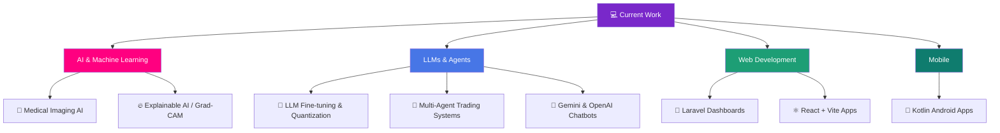

# Welcome to Arman Ali's profile! <a href="https://github.com/armanali850-rgb"></a>

<div align="center">


<a href="https://github.com/armanali850-rgb">
  
</a>

<!-- ✏️ Replace the # links below with your real profile URLs (delete any you don't use) -->
<p>
  <a href="https://github.com/armanali850-rgb"></a>
  <a href="#"></a>
  <a href="#"></a>
  <a href="mailto:your-email@example.com"></a>
  <a href="#" target="_blank"></a>
</p>


</div>

---

<div align="center">

### 🧭 Quick Navigation

[👋 About](#-talking-about-personal-stuff) · [🛠️ Tools](#️-my-favourite-tools) · [🚀 Projects](#-featured-projects) · [📊 Stats](#-devops-stats-matrix) · [🌟 Focus](#-skills--interests)

</div>

---

I am a **Software Engineer** focused on **Artificial Intelligence** — from deep learning models that analyze medical images, to LLM fine-tuning and multi-agent systems that collaborate to make decisions.

Alongside AI, I build **full-stack web platforms** (Laravel, PHP, React) and **native Android apps** (Kotlin), so I can take an idea from a trained model all the way to a product people actually use.

That's why I like to make things that make a difference.


### 🙋 Talking about Personal Stuff:

- 👨‍🎓 I'm a **Software Engineer & AI/ML Developer**
- 🩻 Built **XRayInsight-AI** — chest X-ray classification with DenseNet-121 + Grad-CAM
- 🧠 Exploring **LLM fine-tuning, quantization & local inference**
- 🤖 Building **multi-agent LLM systems** with LangChain, OpenAI & Gemini
- 💬 Python · PyTorch · FastAPI · LangChain · React · Laravel · Kotlin
- 📱 Shipping **Android apps** and **full-stack dashboards**
- 👯 Open to **collaborate on AI & open-source projects**
- 📬 How to reach me: [your-email@example.com](mailto:your-email@example.com)
- 💪 This is where I write, code and solve problems:

<br clear="right"/>

### 👨‍💻 About Me

```typescript
const arman: Developer = {
  name:     "Arman Ali",
  role:     "AI/ML Engineer & Full-Stack Developer",
  location: "🌍 Open to Remote",

  focus: [
    "🩻 Medical imaging AI — classification & explainability (Grad-CAM)",
    "🧠 LLM fine-tuning, RL & quantization for local models",
    "🤖 Multi-agent LLM systems for trading & productivity",
    "🌐 Full-stack platforms with role-based dashboards",
    "📱 Native Android apps with Kotlin",
  ],

  stack: {
    languages: ["Python", "JavaScript", "PHP", "Kotlin", "SQL"],
    ai_ml:     ["PyTorch", "DenseNet", "Hugging Face", "LangChain", "OpenAI", "Gemini"],
    backend:   ["FastAPI", "Laravel", "Node.js"],
    frontend:  ["React", "Vite", "Blade", "HTML/CSS"],
    mobile:    ["Kotlin", "Android SDK"],
    database:  ["MySQL", "SQLite"],
    tools:     ["Git", "Jupyter", "VS Code", "Android Studio", "Postman"],
  },

  principle: "Build · Ship · Learn · Repeat",
};
```

---

## 🛠️ My Favourite tools

### 👨‍💻 Programming languages

<p>
    <a href="#"></a>
    <a href="#"></a>
    <a href="#"></a>
    <a href="#"></a>
    <a href="#"></a>
    <a href="#"></a>
    <a href="#"></a>
    <a href="#"></a>
    <a href="#"></a>
</p>

### 🧠 AI, ML & LLMs

<p>
    <a href="#"></a>
    <a href="#"></a>
    <a href="#"></a>
    <a href="#"></a>
    <a href="#"></a>
    <a href="#"></a>
    <a href="#"></a>
    <a href="#"></a>
    <a href="#"></a>
</p>

### 🧰 Frameworks and libraries

<p>
    <a href="#"></a>
    <a href="#"></a>
    <a href="#"></a>
    <a href="#"></a>
    <a href="#"></a>
    <a href="#"></a>
    <a href="#"></a>
    <a href="#"></a>
</p>

### 🗄️ Databases and Cloud Hosting

<p>
    <a href="#"></a>
    <a href="#"></a>
    <a href="#"></a>
    <a href="#"></a>
    <a href="#"></a>
</p>

### 💻 Software and tools

<p>
    <a href="#"></a>
    <a href="#"></a>
    <a href="#"></a>
    <a href="#"></a>
    <a href="#"></a>
    <a href="#"></a>
    <a href="#"></a>
    <a href="#"></a>
</p>

<table align="center">
    <tr>
        <td align="center" width="90">
            
            <br>Python
        </td>
        <td align="center" width="90">
            
            <br>PyTorch
        </td>
        <td align="center" width="90">
            
            <br>FastAPI
        </td>
        <td align="center" width="90">
            
            <br>TensorFlow
        </td>
        <td align="center" width="90">
            
            <br>Scikit-learn
        </td>
        <td align="center" width="90">
            
            <br>OpenCV
        </td>
        <td align="center" width="90">
            
            <br>REST API
        </td>
    </tr>
    <tr>
        <td align="center" width="90">
            
            <br>React
        </td>
        <td align="center" width="90">
            
            <br>JavaScript
        </td>
        <td align="center" width="90">
            
            <br>Vite
        </td>
        <td align="center" width="90">
            
            <br>Node.js
        </td>
        <td align="center" width="90">
            
            <br>Tailwind
        </td>
        <td align="center" width="90">
            
            <br>HTML
        </td>
        <td align="center" width="90">
            
            <br>CSS
        </td>
    </tr>
    <tr>
        <td align="center" width="90">
            
            <br>PHP
        </td>
        <td align="center" width="90">
            
            <br>Laravel
        </td>
        <td align="center" width="90">
            
            <br>MySQL
        </td>
        <td align="center" width="90">
            
            <br>SQLite
        </td>
        <td align="center" width="90">
            
            <br>Kotlin
        </td>
        <td align="center" width="90">
            
            <br>Android
        </td>
        <td align="center" width="90">
            
            <br>Docker
        </td>
    </tr>
    <tr>
        <td align="center" width="90">
            
            <br>Git
        </td>
        <td align="center" width="90">
            
            <br>GitHub
        </td>
        <td align="center" width="90">
            
            <br>VS Code
        </td>
        <td align="center" width="90">
            
            <br>Linux
        </td>
        <td align="center" width="90">
            
            <br>Postman
        </td>
        <td align="center" width="90">
            
            <br>PostgreSQL
        </td>
        <td align="center" width="90">
            
            <br>Vercel
        </td>
    </tr>
</table>
<br />

---

<div align="center">

</div>

## 🚀 Featured Projects

### ⭐ Flagship: XRayInsight-AI

**🩻 [XRayInsight-AI](https://github.com/armanali850-rgb/XRayInsight-AI)** — *AI-powered chest X-ray analysis.*

A deep learning system that classifies lung conditions from chest X-rays and explains *why* it made each prediction.

- 🧠 **DenseNet-121** backbone fine-tuned in **PyTorch** for chest X-ray classification
- 🔥 **Grad-CAM heatmaps** that highlight the regions of the X-ray driving each prediction
- 📊 **Confidence scores** for every class, so results are never a black box
- ⚡ **FastAPI** backend serving real-time inference
- 🗂️ **Prediction history** to review and compare past scans

   

### 🤖 AI / ML & LLMs

| Project | Description | Tech | Source |
|---|---|---|---|
| 🧠 **Unsloth-LLM-Studio** | LLM training & inference framework — GPU-optimized fine-tuning, reinforcement learning, quantization and a web UI for running models locally. |   | [Repo](https://github.com/armanali850-rgb/Unsloth-LLM-Studio) |
| 📈 **TradingAgent** | Multi-agent LLM framework where agents collaborate to analyze market trends, evaluate risk and support trading decisions. |   | [Repo](https://github.com/armanali850-rgb/TradingAgent) |
| 📋 **FlowManager-AI** | AI project-management assistant — tracks tasks, writes progress summaries and flags blockers from the command line. |   | [Repo](https://github.com/armanali850-rgb/FlowManager-AI) |
| 💬 **GeminiFlow-AI** | Responsive AI chatbot with real-time Gemini responses, typing animations and a modern chat UI. |   | [Repo](https://github.com/armanali850-rgb/GeminiFlow-AI) |

### 🌐 Web & Full-Stack

| Project | Description | Tech | Source |
|---|---|---|---|
| 🎀 **Pinkme_Dashboard** | Patient & program management platform — role-based dashboards, case management, event registration and financial workflows. |   | [Repo](https://github.com/armanali850-rgb/Pinkme_Dashboard) |
| 🏫 **EduCore-School-Management** | School management system with portals for students, teachers, admins and registrar staff. |   | [Repo](https://github.com/armanali850-rgb/EduCore-School-Management) |

### 📱 Mobile & Automation

| Project | Description | Tech | Source |
|---|---|---|---|
| 💰 **FinTrack-Android** | Personal finance app — income, expenses, savings, budget planning and spending analytics. |   | [Repo](https://github.com/armanali850-rgb/FinTrack-Android) |
| 🔎 **Leads Scraping (Google + LinkedIn)** | Lead-generation pipeline — extracts businesses from Google Maps, finds owners via LinkedIn and enriches contacts with ContactOut & Apollo APIs. |   | [Repo](https://github.com/armanali850-rgb/Leads_Scrapping_via-Google-linkedin_Py) |

<div align="center">

<a href="https://github.com/armanali850-rgb/XRayInsight-AI">
  
</a>
<a href="https://github.com/armanali850-rgb/Unsloth-LLM-Studio">
  
</a>
<a href="https://github.com/armanali850-rgb/TradingAgent">
  
</a>
<a href="https://github.com/armanali850-rgb/Pinkme_Dashboard">
  
</a>

</div>

### 💡 What I'm Building



---

<h2 align="center">📊 DevOps Stats Matrix</h2>
<div align="center">


<br>


<br><br>


<br>


</div>
<br/>

<!-- Pac-Man contribution graph — generated by .github/workflows/pacman.yml -->
<p align="center">
  <picture>
    <source media="(prefers-color-scheme: dark)" srcset="https://raw.githubusercontent.com/armanali850-rgb/armanali850-rgb/output/pacman-contribution-graph-dark.svg">
    <source media="(prefers-color-scheme: light)" srcset="https://raw.githubusercontent.com/armanali850-rgb/armanali850-rgb/output/pacman-contribution-graph.svg">
    
  </picture>
</p>

---

<div align="center">

## 🌟 Skills & Interests

</div>

<table>
  <tr>
    <td width="33%" valign="top">
      <h3>🎯 Currently Focused On</h3>
      - 🩻 Improving <strong>medical imaging AI</strong><br>
      - 🧠 <strong>LLM fine-tuning</strong> & quantization<br>
      - 🤖 <strong>Multi-agent</strong> LLM systems<br>
      - 👯 <strong>Open source</strong> contributions<br>
      - 🤝 <strong>Collaboration</strong> opportunities
    </td>
    <td width="33%" valign="top">
      <h3>🌱 Currently Learning</h3>
      - 📚 RAG & vector databases<br>
      - 🐳 Docker & cloud deployment<br>
      - ⚙️ MLOps & model serving<br>
      - 🎨 Jetpack Compose<br>
      - 🚀 System design
    </td>
    <td width="33%" valign="top">
      <h3>💬 Ask Me About</h3>
      - 🔥 Grad-CAM & explainable AI<br>
      - 🧩 LangChain & AI agents<br>
      - ⚡ FastAPI model serving<br>
      - 🎀 Laravel dashboards<br>
      - 📱 Android with Kotlin
    </td>
  </tr>
</table>

---

<div align="center">


<br>

### 🤝 Let's Build Something Together

[](mailto:your-email@example.com)
[](https://github.com/armanali850-rgb)


</div>


